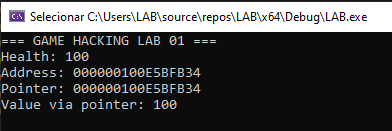
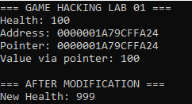
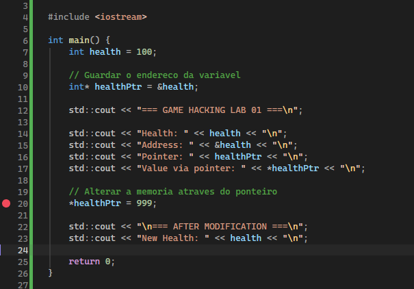
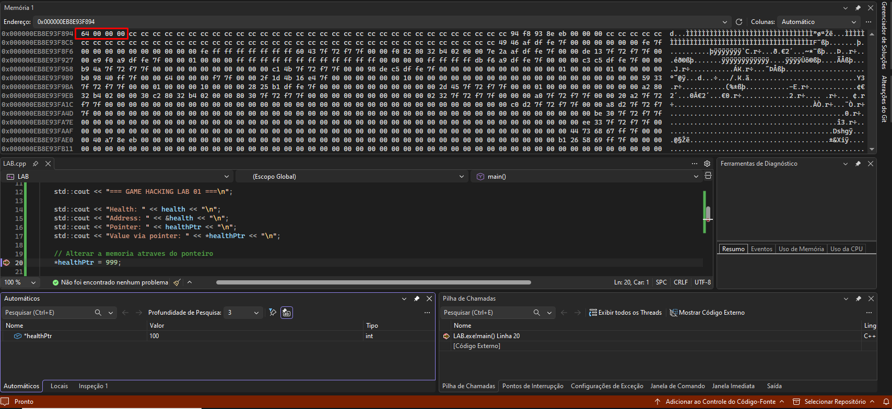
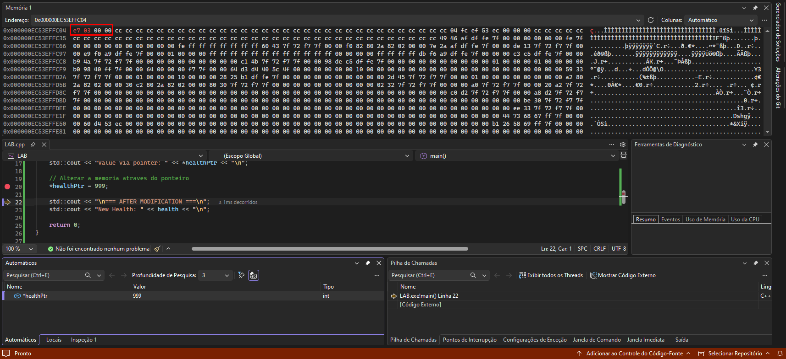
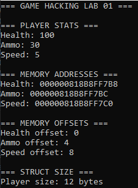
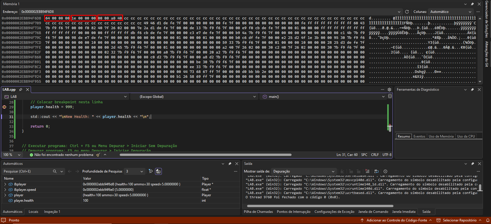
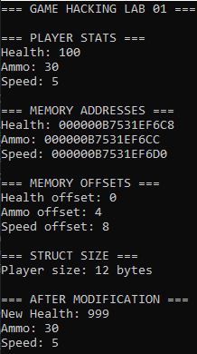
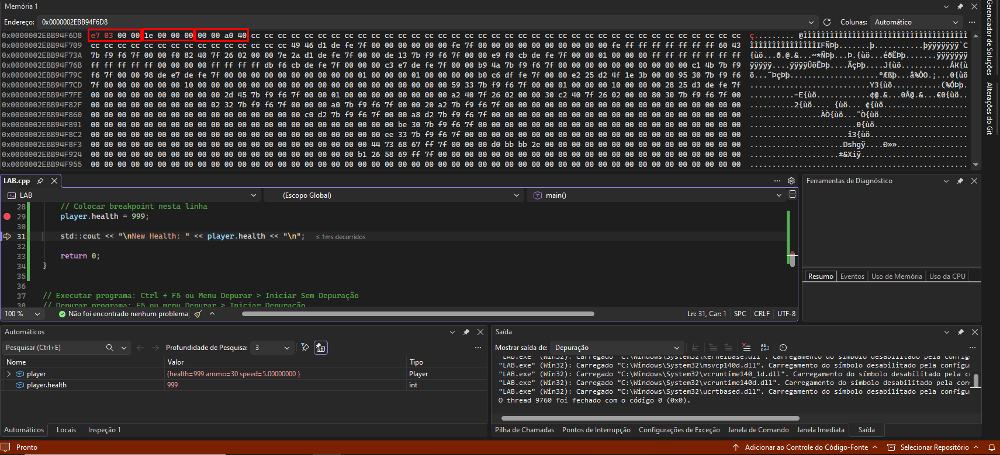

# DAY 1 - Cheating LAB

> **Status:** Completed  
> **Environment:** C++ · Visual Studio Community · Windows 11 Pro x64 (VM) · Debug x64

## Learning Objectives

- Understand C/C++ fundamentals in the context of games.
- Understand variables, pointers, and memory addresses.
- Observe how values are read and modified using the debugger.
- Explore the memory layout of a `struct` and its member offsets.

---

## 1. First Test - Reading a Variable Through a Pointer

### Source Code

```cpp
#include <iostream>

int main() {
    int health = 100;

    // Store the variable's address
    int* healthPtr = &health;

    std::cout << "=== GAME HACKING LAB 01 ===\n";

    std::cout << "Health: " << health << "\n";
    std::cout << "Address: " << &health << "\n";
    std::cout << "Pointer: " << healthPtr << "\n";
    std::cout << "Value via pointer: " << *healthPtr << "\n";

    return 0;
}
```



**Observation:** The address displayed by `&health` matches the address stored in `healthPtr`. Accessing `*healthPtr` returns the value `100`.

## 2. Second Test - Modifying a Value Through a Pointer

### Source Code

```cpp
#include <iostream>

int main() {
    int health = 100;

    // Store the variable's address
    int* healthPtr = &health;

    std::cout << "=== GAME HACKING LAB 01 ===\n";

    std::cout << "Health: " << health << "\n";
    std::cout << "Address: " << &health << "\n";
    std::cout << "Pointer: " << healthPtr << "\n";
    std::cout << "Value via pointer: " << *healthPtr << "\n";

    // Modify memory through the pointer
    *healthPtr = 999;

    std::cout << "\n=== AFTER MODIFICATION ===\n";
    std::cout << "New Health: " << health << "\n";

    return 0;
}
```



**Observation:** Writing `*healthPtr = 999` modifies the original variable rather than a copy of its value.

## 3. Analyzing Memory with the Visual Studio Debugger

We placed a breakpoint before the `*healthPtr = 999;` instruction to inspect memory before and after the modification.

We used **F5** to start debugging and **F10** to step through instructions (*Step Over*). The Memory window allowed us to inspect the bytes at the relevant address.

### 3.1. Breakpoint Before Modification



### 3.2. Memory Before Modification

Before executing the instruction, we found the `health` value of **100** in decimal, equivalent to **`0x64`** in hexadecimal.



### 3.3. Memory After Modification

After stepping over the instruction with **F10**, we observed the value change to **999** in decimal, equivalent to **`0x3E7`** in hexadecimal.



**Interpretation:** The `*` operator provides access to the contents of the address stored in a pointer. Writing `*healthPtr = 999` modifies the original variable without changing the address to which the pointer points.

---

## 4. Third Test - The `Player` Structure

### Source Code

```cpp
#include <iostream>
#include <cstddef>

struct Player {
    int health = 100;
    int ammo = 30;
    float speed = 5.0f;
};

int main() {
    Player player;

    std::cout << "=== GAME HACKING LAB 01 ===\n";

    // Initial player values
    std::cout << "\n=== PLAYER STATS ===\n";
    std::cout << "Health: " << player.health << "\n";
    std::cout << "Ammo: " << player.ammo << "\n";
    std::cout << "Speed: " << player.speed << "\n";

    // Memory addresses
    std::cout << "\n=== MEMORY ADDRESSES ===\n";
    std::cout << "Health: " << &player.health << "\n";
    std::cout << "Ammo: " << &player.ammo << "\n";
    std::cout << "Speed: " << &player.speed << "\n";

    // Member offsets in the structure
    std::cout << "\n=== MEMORY OFFSETS ===\n";
    std::cout << "Health offset: "
        << offsetof(Player, health) << "\n";

    std::cout << "Ammo offset: "
        << offsetof(Player, ammo) << "\n";

    std::cout << "Speed offset: "
        << offsetof(Player, speed) << "\n";

    // Total structure size
    std::cout << "\n=== STRUCT SIZE ===\n";
    std::cout << "Player size: "
        << sizeof(Player) << " bytes\n";

    // Set a breakpoint on this line (F9)
    player.health = 999;

    // Check the modification
    std::cout << "\n=== AFTER MODIFICATION ===\n";
    std::cout << "New Health: " << player.health << "\n";
    std::cout << "Ammo: " << player.ammo << "\n";
    std::cout << "Speed: " << player.speed << "\n";

    return 0;
}
```

> **Note:** The [`LAB.cpp`](LAB.cpp) file contains this final version of the third test. The source code for the first two tests is documented in the previous sections.

### 4.1. The `Player` Structure

A `struct` in C++ groups several related variables into a single data type.

In this lab, we created a `Player` structure with three members:

- `health` — player health (`int`).
- `ammo` — player ammunition (`int`).
- `speed` — player speed (`float`).

Each member occupies memory. In our Windows x64 environment, both `int` and `float` occupy 4 bytes.

### 4.2. Memory Layout and Offsets

An **offset** is the distance, in bytes, between a reference address and another address. For a structure, we use the structure's starting address as the reference.

In the observed example, the members are located 4 bytes apart:

| Member | Type | Size | Offset |
|---|---|---|---|
| `health` | `int` | 4 bytes | `0x00` |
| `ammo` | `int` | 4 bytes | `0x04` |
| `speed` | `float` | 4 bytes | `0x08` |

If the structure started at address `0x1000`, the member addresses would be:

- `health` → `0x1000`
- `ammo` → `0x1004`
- `speed` → `0x1008`

In this build, `sizeof(Player)` returned **12 bytes**. This layout applies to the structure used in this lab, but other structures may contain *padding* due to memory alignment requirements.

### 4.3. Observing Memory in the Debugger

Using Visual Studio, we inspected the addresses of all three members and examined their values in the Memory window.

In this **third test**, the instruction `player.health = 999;` modifies the member **directly**, without using an explicit pointer. This differs from the **second test**, where we used `*healthPtr = 999;` to modify a variable through a pointer.

Changing `player.health` from `100` to `999` modified the player's health, while `ammo` remained at `30` and `speed` at `5.0`. The member offsets remained unchanged.









---

## 5. Theoretical Concepts

### 5.1. Variables and Memory

A variable is a storage location associated with a data type and a value.

```cpp
int health = 100;
```

- `int` — data type (4 bytes in the environment used).
- `health` — variable name.
- `100` — initial value.

During execution, the value may be stored in physical memory and accessed through the process's virtual address space.

### 5.2. Memory Addresses

Each addressable byte of memory has an address. The `&` operator retrieves a variable's address.

```cpp
std::cout << &health;
```

Addresses are typically displayed in hexadecimal, using the characters `0–9` and `A–F`.

Addresses can vary between program runs due to process memory layout and security mechanisms such as **ASLR** (*Address Space Layout Randomization*).

### 5.3. Pointers

A pointer is a variable that stores a memory address.

```cpp
int* healthPtr = &health;
```

- `int*` — declares a pointer to an integer.
- `healthPtr` — pointer name.
- `&health` — retrieves the address of the `health` variable.

The pointer does not hold a copy of `health`'s value; it stores the address at which that value is located.

### 5.4. Dereferencing

When applied to a pointer in an expression, the `*` operator accesses the value stored at the address to which the pointer points.

```cpp
std::cout << *healthPtr;
```

Result: `100`.

We can also write to that address:

```cpp
*healthPtr = 999;
```

In this case, `health` changes from `100` to `999`.

**Important:** Modifying a variable's contents through a pointer does not mean changing the variable's address.

### 5.5. Operator Summary

| Expression | Meaning |
|---|---|
| `health` | Variable value |
| `&health` | Variable address |
| `healthPtr` | Address stored in the pointer |
| `*healthPtr` | Value at the address being pointed to |
| `*healthPtr = 999` | Write to the pointed-to address |

---

## 6. Connection to Game Hacking

Games use memory to store data such as health, ammunition, coordinates, and object states.

Understanding pointers, structures, and addresses is essential when studying how this data is organized and manipulated.

In this lab, we modified the memory of our own program. In future labs, we will study how debuggers and memory analysis tools inspect processes in controlled and authorized environments.

## 7. Results Achieved

- Compiled a C++ program on Windows x64.
- Retrieved the address of a variable.
- Created a pointer to that variable.
- Read a value through the pointer.
- Changed the value from `100` to `999` through a pointer in the second test.
- Created a `Player` structure containing health, ammunition, and speed.
- Identified offsets `0`, `4`, and `8`, and a total size of `12` bytes in this build.
- Directly changed `player.health` from `100` to `999` in the third test.
- Inspected values before and after the modifications in the debugger.
- Observed different absolute addresses across executions while the structure's offsets remained unchanged.

**Main takeaway:** A pointer provides indirect access to a variable through its memory address. Offsets let us locate structure members relative to the structure's starting address. These concepts provide an essential foundation for memory analysis and reverse engineering.
