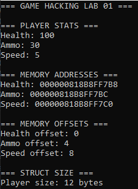

# DIA 1 - Cheating LAB

> **Estado:** Em progresso  
> **Ambiente:** C++ · Visual Studio · Windows x64

## Objetivos do dia

- Entender os fundamentos de C/C++ aplicados a jogos.
- Compreender variáveis, ponteiros e endereços de memória.
- Observar a leitura e a alteração de valores com o debugger.

---

## 1. Primeiro teste - Ler uma variável através de um ponteiro

### Código utilizado

```cpp
#include <iostream>

int main() {
    int health = 100;

    // Guardar o endereco da variavel
    int* healthPtr = &health;

    std::cout << "=== GAME HACKING LAB 01 ===\n";

    std::cout << "Health: " << health << "\n";
    std::cout << "Address: " << &health << "\n";
    std::cout << "Pointer: " << healthPtr << "\n";
    std::cout << "Value via pointer: " << *healthPtr << "\n";

    return 0;
}
```


**Observação:** O endereço apresentado por `&health` coincide com o endereço guardado em `healthPtr`. O acesso por `*healthPtr` devolve o valor `100`.

## 2. Segundo teste - Alterar o valor através de um ponteiro

### Código utilizado

```cpp
#include <iostream>

int main() {
    int health = 100;

    // Guardar o endereco da variavel
    int* healthPtr = &health;

    std::cout << "=== GAME HACKING LAB 01 ===\n";

    std::cout << "Health: " << health << "\n";
    std::cout << "Address: " << &health << "\n";
    std::cout << "Pointer: " << healthPtr << "\n";
    std::cout << "Value via pointer: " << *healthPtr << "\n";

    // Alterar a memoria atraves do ponteiro
    *healthPtr = 999;

    std::cout << "\n=== AFTER MODIFICATION ===\n";
    std::cout << "New Health: " << health << "\n";

    return 0;
}
```


**Observação:** Ao escrever `*healthPtr = 999`, modificámos a variável original, e não uma cópia do valor.

## 3. Análise com o debugger do Visual Studio

Colocámos um breakpoint antes da instrução `*healthPtr = 999;` para observar o conteúdo da memória antes e depois da alteração.

Para iniciar a depuração utilizámos **F5**. Para avançar instrução a instrução utilizámos **F10** (*Step Over*). A janela de memória permitiu inspecionar os bytes no endereço observado.

### 3.1. Breakpoint antes da alteração


### 3.2. Memória antes da alteração

Antes de executar a instrução, encontrámos o valor de `health` correspondente a **100** em decimal, ou **`0x64`** em hexadecimal.


### 3.3. Memória depois da alteração

Ao avançar com **F10** e executar a instrução, observámos o valor passar para **999** em decimal, equivalente a **`0x3E7`** em hexadecimal.


**Interpretação:** O operador `*` permite aceder ao conteúdo do endereço guardado pelo ponteiro. Quando escrevemos `*healthPtr = 999`, modificamos a variável original, sem alterar o endereço para o qual o ponteiro aponta.

---

## 4. Terceiro Teste - struct do Player

```cpp

#include <iostream>
#include <cstddef>

struct Player {
    int health = 100;
    int ammo = 30;
    float speed = 5.0f;
};

int main() {
    Player player;

    std::cout << "=== GAME HACKING LAB 01 ===\n";

    // Valores iniciais do jogador
    std::cout << "\n=== PLAYER STATS ===\n";
    std::cout << "Health: " << player.health << "\n";
    std::cout << "Ammo: " << player.ammo << "\n";
    std::cout << "Speed: " << player.speed << "\n";

    // Enderecos de memoria
    std::cout << "\n=== MEMORY ADDRESSES ===\n";
    std::cout << "Health: " << &player.health << "\n";
    std::cout << "Ammo: " << &player.ammo << "\n";
    std::cout << "Speed: " << &player.speed << "\n";

    // Offsets dos atributos na estrutura
    std::cout << "\n=== MEMORY OFFSETS ===\n";
    std::cout << "Health offset: "
        << offsetof(Player, health) << "\n";

    std::cout << "Ammo offset: "
        << offsetof(Player, ammo) << "\n";

    std::cout << "Speed offset: "
        << offsetof(Player, speed) << "\n";

    // Tamanho total da estrutura
    std::cout << "\n=== STRUCT SIZE ===\n";
    std::cout << "Player size: "
        << sizeof(Player) << " bytes\n";

    // Colocar breakpoint nesta linha (F9)
    player.health = 999;

    // Verificar alteracao
    std::cout << "\n=== AFTER MODIFICATION ===\n";
    std::cout << "New Health: " << player.health << "\n";
    std::cout << "Ammo: " << player.ammo << "\n";
    std::cout << "Speed: " << player.speed << "\n";

    return 0;
}
```
### Estrutura de um Player

Uma `struct` em C++ permite agrupar várias variáveis relacionadas dentro de um único tipo de dados.

Neste laboratório, criámos uma estrutura `Player` com três atributos:

- `health` - vida do jogador (`int`).
- `ammo` - munição do jogador (`int`).
- `speed` - velocidade do jogador (`float`).

Cada atributo ocupa espaço em memória. No nosso ambiente Windows x64, estes três tipos ocupam normalmente 4 bytes cada.

### Organização da memória e offsets

Um **offset** representa a distância, em bytes, entre um endereço de referência e outro endereço.

No exemplo observado, os atributos encontram-se em endereços consecutivos, separados por 4 bytes:

| Atributo | Tipo | Tamanho | Offset |
|---|---|---|---|
| `health` | `int` | 4 bytes | `0x00` |
| `ammo` | `int` | 4 bytes | `0x04` |
| `speed` | `float` | 4 bytes | `0x08` |

Assim, considerando o endereço inicial da estrutura como `0x1000`, teríamos:

- `health` → `0x1000`
- `ammo` → `0x1004`
- `speed` → `0x1008`

Esta disposição corresponde à estrutura utilizada neste laboratório, mas outras estruturas podem conter espaços de preenchimento (*padding*) devido a requisitos de alinhamento de memória.

### Observação no debugger

Com o Visual Studio, podemos observar os endereços dos três atributos e identificar os respetivos valores na janela de memória.

A alteração de `player.health` de `100` para `999` modifica os bytes correspondentes à vida do jogador, sem necessariamente alterar os restantes atributos.

Este teste demonstra como diferentes valores de um objeto podem ser localizados a partir de um endereço base e dos respetivos offsets.
Um offset é a distância, em bytes, entre um endereço de referência e outro endereço.

Por exemplo, se health estiver em 0x1000, ammo poderá estar em 0x1004 e speed em 0x1008.




## 4. Conceitos teóricos

### 4.1. Variáveis e memória

Uma variável é um espaço de armazenamento associado a um tipo de dados e a um valor.

```cpp
int health = 100;
```

- `int` - tipo de dados (normalmente 4 bytes).
- `health` - nome da variável.
- `100` - valor inicial.

Durante a execução, o valor pode estar armazenado na memória física, sendo acedido através do espaço de endereçamento virtual do processo.

### 4.2. Endereços de memória

Cada byte de memória endereçável tem um endereço. O operador `&` permite obter o endereço de uma variável.

```cpp
std::cout << &health;
```

O endereço é normalmente apresentado em hexadecimal, com os caracteres `0–9` e `A–F`.

Os endereços podem variar entre execuções devido à organização da memória do processo e a mecanismos de segurança como o **ASLR** (*Address Space Layout Randomization*).

### 4.3. Ponteiros (*Pointers*)

Um ponteiro é uma variável que armazena um endereço de memória.

```cpp
int* healthPtr = &health;
```

- `int*` - declara um ponteiro para um inteiro.
- `healthPtr` - nome do ponteiro.
- `&health` - obtém o endereço da variável `health`.

O ponteiro não contém uma cópia do valor de `health`; contém o endereço onde esse valor está armazenado.

### 4.4. Desreferenciação (*Dereferencing*)

O operador `*`, aplicado a um ponteiro numa expressão, permite aceder ao valor armazenado no endereço apontado.

```cpp
std::cout << *healthPtr;
```

Resultado: `100`.

Também podemos escrever nesse endereço:

```cpp
*healthPtr = 999;
```

Neste caso, o valor de `health` passa de `100` para `999`.

**Importante:** Alterar o conteúdo de uma variável através de um ponteiro não significa alterar o endereço da variável.

### 4.5. Resumo dos operadores

| Expressão | Significado |
| --- | --- |
| `health` | Valor da variável |
| `&health` | Endereço da variável |
| `healthPtr` | Endereço guardado no ponteiro |
| `*healthPtr` | Valor no endereço apontado |
| `*healthPtr = 999` | Escrita no endereço apontado |

## 5. Relação com Game Hacking

Os jogos utilizam memória para armazenar dados como vida, munição, coordenadas e estados dos objetos.

Compreender ponteiros e endereços é essencial para estudar como esses dados são organizados e manipulados.

Neste laboratório, modificámos a memória do nosso próprio programa. Futuramente, estudaremos como os debuggers e as ferramentas de análise de memória observam os processos.

## 6. Resultados obtidos até agora

- Compilámos um programa C++ em Windows x64.
- Obtivemos o endereço de uma variável.
- Criámos um ponteiro para essa variável.
- Lemos o valor através do ponteiro.
- Alterámos o valor de `100` para `999`.
- Observámos os valores antes e depois da alteração no debugger.
- Observámos endereços diferentes entre duas execuções.

**Aprendizagem até agora:** Um ponteiro permite aceder indiretamente a uma variável através do seu endereço de memória. Esta é uma das bases para compreender a manipulação de memória e a engenharia inversa.

---

*Laboratório em progresso — continuar a documentar os próximos testes abaixo desta secção.*
